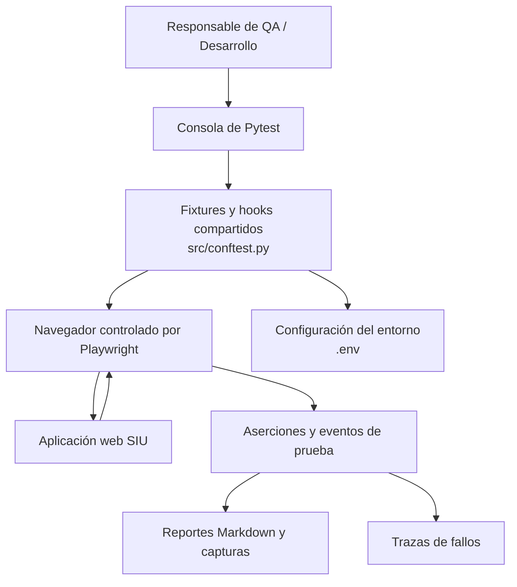

<div align="center">

# 🛡️ QA-SIU

### Aseguramiento de calidad automatizado · Pruebas de extremo a extremo

**Framework de automatización de pruebas E2E en navegadores para el sistema SIU, desarrollado con Python, Playwright y Pytest.**

[](https://www.python.org/)
[](https://playwright.dev/python/)
[](https://docs.pytest.org/)
[](https://github.com/UrielMartinez21/QA-SIU)

**Flujos de navegación** · **Evidencia automatizada** · **Diagnósticos de red** · **Trazas de fallos**

[Descripción](#descripción-general) · [Arquitectura](#arquitectura) · [Inicio rápido](#inicio-rápido) · [Ejecución](#ejecución-de-pruebas) · [Reportes](#reportes-y-evidencias) · [Seguridad](#seguridad-de-los-datos)

</div>

---

## Descripción general

**QA-SIU** es un proyecto independiente de pruebas de **extremo a extremo (End-to-End, E2E)** para la aplicación web **SIU**. Reproduce flujos de trabajo en el navegador que normalmente validaría una persona de QA, comenzando por la **carga de archivos de hojas de cálculo del módulo de Finanzas/Contabilidad**.

La automatización se ejecuta **fuera del código fuente de la aplicación SIU**. Interactúa con su interfaz web de la misma manera que un usuario, lo que permite validar un entorno local o desplegado al que se tenga acceso sin modificar la implementación del sistema.

> [!NOTE]
> Las pruebas E2E en navegador complementan, pero no sustituyen, las pruebas unitarias del backend, las pruebas de integración ni las verificaciones directas de la base de datos.

## Características principales

| Funcionalidad | Descripción |
| :--- | :--- |
| 🌐 **Pruebas E2E en navegador** | Automatiza la navegación, las interacciones y las verificaciones de comportamiento con Playwright. |
| 🧪 **Ejecución con Pytest** | Organiza y ejecuta pruebas por módulo, archivo, función o filtro de nombre. |
| 🔐 **Configuración por entorno** | Obtiene la URL de destino y las credenciales de prueba desde un archivo `.env` no versionado. |
| 📷 **Capturas de pantalla** | Captura evidencia visual de las pruebas que llegan a su fase de ejecución, tanto exitosas como fallidas. |
| 📝 **Evidencia en Markdown** | Genera reportes `.md` individuales, agrupados por la fecha y hora de ejecución. |
| 📡 **Diagnósticos del navegador** | Registra solicitudes, errores HTTP, errores de la consola JavaScript, tiempos de navegación y descargas. |
| 🔎 **Investigación de fallos** | Conserva trazas de Playwright en ejecuciones fallidas para analizarlas en Trace Viewer. |
| 🧩 **Fixtures reutilizables** | Comparte la configuración del navegador, la URL, las credenciales y metadatos opcionales para los reportes. |

## Tecnologías utilizadas

| Tecnología | Función |
| :--- | :--- |
| **Python 3.13** | Versión de Python indicada en la documentación del repositorio. |
| **Playwright para Python** | Automatización de navegadores y recopilación de trazas. |
| **pytest-playwright `0.9.0`** | Complemento de Pytest que proporciona fixtures para navegadores. |
| **Pytest** | Descubrimiento, ejecución y aserciones de las pruebas (instalado mediante el complemento). |
| **python-dotenv `1.2.3`** | Lectura de las variables locales del archivo `.env`. |

> [!IMPORTANT]
> `src/conftest.py` importa `slugify`, pero el archivo `requirements.txt` revisado **no declara explícitamente** el paquete que proporciona ese módulo. Si una instalación limpia produce el error `ModuleNotFoundError: No module named 'slugify'`, instala `python-slugify` (`python -m pip install python-slugify`). Para hacer las instalaciones reproducibles, también debe agregarse a las dependencias del proyecto. Este README no modifica `requirements.txt`.

## Arquitectura



**Flujo de ejecución:** Pytest descubre las pruebas de `src/tests/`, las fixtures compartidas proporcionan la configuración del navegador y del entorno, Playwright interactúa con SIU y los hooks personalizados guardan las evidencias en `reportes/`.

## Estructura del repositorio

```text
QA-SIU/
├── README.md
├── requirements.txt
├── pytest.ini
├── .env.example
├── .gitignore
├── docs/
│   ├── guia_playwright_e2e.md
│   └── notas_qa_testing.md
└── src/
    ├── conftest.py              # Fixtures compartidas y hooks de evidencia
    ├── helpers/                # Funciones auxiliares reutilizables
    ├── tests/                  # Pruebas E2E organizadas por módulo
    │   └── finanzas/
    │       └── test_carga_contable.py
    └── fixtures/               # Insumos de prueba organizados por módulo
        └── finance/
            └── README.md
```

Las evidencias generadas se almacenan por separado:

```text
reportes/
└── YYYY-MM-DD_HHMMSS/
    ├── test_example.md
    ├── test_example.png
    └── test_example_trace.zip   # Cuando se conserva una traza de fallo
```

> El árbol anterior representa la estructura documentada del proyecto. Los archivos generados son ejemplos; sus nombres dependen de las pruebas ejecutadas.

## Inicio rápido

### 1. Clonar el repositorio

```bash
git clone https://github.com/UrielMartinez21/QA-SIU.git
cd QA-SIU
```

### 2. Crear y activar un entorno virtual

**Windows — PowerShell**

```powershell
py -3.13 -m venv venv
.\venv\Scripts\Activate.ps1
```

**macOS / Linux**

```bash
python3.13 -m venv venv
source venv/bin/activate
```

Si ya existe un entorno virtual funcional en tu equipo, puedes activarlo en lugar de crear otro. Los entornos virtuales son específicos de cada equipo y no deben considerarse archivos del repositorio que deban versionarse.

### 3. Instalar dependencias y navegadores

```bash
python -m pip install -r requirements.txt
python -m playwright install
```

En una instalación limpia, resuelve también la dependencia de `slugify` mencionada en [Tecnologías utilizadas](#tecnologías-utilizadas), si es necesario.

### 4. Configurar las credenciales y la URL de destino

**Windows — PowerShell**

```powershell
Copy-Item .env.example .env
```

**macOS / Linux**

```bash
cp .env.example .env
```

Abre el archivo `.env` y establece los valores de una **cuenta de pruebas**:

```dotenv
E2E_USER=your_test_username
E2E_PASSWORD=your_test_password
E2E_BASE_URL=http://localhost:8000
```

| Variable | Descripción |
| :--- | :--- |
| `E2E_USER` | Nombre de usuario o matrícula que utilizarán las pruebas. |
| `E2E_PASSWORD` | Contraseña de la cuenta de pruebas. |
| `E2E_BASE_URL` | URL raíz del entorno SIU que se probará; si no se establece, el valor predeterminado es `http://localhost:8000`. |

Los escenarios de carga contable requieren que el usuario de pruebas tenga el permiso **`finanzas.can_upload_accounting_excel`** de la aplicación.

> [!CAUTION]
> Nunca incluyas en los commits el archivo `.env`, archivos de almacenamiento de sesión, credenciales personales, datos de producción ni evidencias sensibles generadas por las pruebas. El `.gitignore` del repositorio está diseñado para excluir datos sensibles y archivos generados, pero debes revisarlo antes de realizar un commit.

### 5. Realizar una comprobación inicial

Inicia el entorno SIU de destino o verifica que sea accesible. Después, ejecuta los comandos desde la raíz del repositorio, donde se encuentra `pytest.ini`:

```bash
python -m pytest --collect-only
python -m pytest --headed
```

**Importante:** `--collect-only` enumera las pruebas sin ejecutar sus flujos de navegador. Una ejecución completa puede modificar datos; consulta [Seguridad de los datos](#seguridad-de-los-datos) antes de ejecutar pruebas que carguen archivos válidos.

## Entornos de ejecución

El archivo `.env.example` del repositorio establece por defecto la aplicación local:

| Entorno | Configuración | Consideraciones |
| :--- | :--- | :--- |
| **Local** | `E2E_BASE_URL=http://localhost:8000` | Requiere que un servidor SIU local esté disponible. |
| **Pruebas / despliegue autorizado** | Cambiar `E2E_BASE_URL` por su URL aprobada. | La conectividad o el acceso por VPN dependen del entorno. |

Puedes seleccionar otro destino modificando `.env`. El README original también documentaba la opción de línea de comandos `--base-url`; sin embargo, `src/conftest.py` actualmente define su propia fixture `base_url` a partir de `E2E_BASE_URL`, por lo que **no está garantizado que la opción de consola tenga prioridad**. Hasta ajustar esa fixture, conviene configurar `E2E_BASE_URL` directamente.

## Ejecución de pruebas

Ejecuta los comandos desde la **carpeta raíz de QA-SIU**.

### Ejecución general

```bash
python -m pytest                          # Todas las pruebas, sin mostrar navegador
python -m pytest --headed                 # Muestra el navegador
python -m pytest --headed --slowmo 500    # Interacciones más lentas para depuración
```

### Ejecución selectiva

```bash
python -m pytest src/tests/finanzas/
python -m pytest src/tests/finanzas/test_carga_contable.py
python -m pytest src/tests/finanzas/test_carga_contable.py::test_pantalla_carga_contable_carga_bien
python -m pytest -k "sin_hoja"
```

### Selección del navegador

```bash
python -m pytest --browser firefox
```

Chromium es el navegador predeterminado del complemento de Playwright para Pytest. Instala previamente los archivos binarios del navegador que utilizarás mediante `python -m playwright install`.

### Configuración actual de Pytest

El archivo `pytest.ini` del repositorio contiene:

```ini
[pytest]
addopts =
    --screenshot=off
    --video=off
    --tracing=retain-on-failure

testpaths = src/tests
python_files = test_*.py
python_functions = test_*
```

El sistema de reportes personalizado se encarga de las capturas de pantalla. Las capturas automáticas y la grabación de video del complemento se encuentran desactivadas intencionalmente. Las trazas de pruebas fallidas sí están habilitadas.

## Reportes y evidencias

`src/conftest.py` utiliza hooks personalizados de Pytest para crear una carpeta identificada con la fecha y hora de cada ejecución dentro de **`reportes/`**. En las pruebas que alcanzan su fase de ejecución, registra:

- **Reportes Markdown** con resultado, fecha, entorno, navegador, archivo de prueba y URL final.
- **Capturas de pantalla** después de la ejecución del caso, siempre que la página siga accesible.
- **Métricas de diagnóstico**, como duración, tiempo de navegación, estado HTTP, conteo de solicitudes y errores, y errores de consola JavaScript.
- **Eventos del navegador** relacionados con navegación y descargas, más pasos o insumos anotados con la fixture opcional `reporte`.
- **Trazas de Playwright** para pruebas fallidas, cuando el archivo de traza puede localizarse y trasladarse a la carpeta de ejecución.

El registrador de eventos **no reconstruye automáticamente cada clic, pulsación de teclado o aserción**. Para obtener evidencia detallada paso a paso, escribe docstrings significativos en las pruebas y utiliza `reporte.paso(...)`.

### Inspeccionar una traza de fallo

```bash
python -m playwright show-trace reportes/YYYY-MM-DD_HHMMSS/test_name_trace.zip
```

Sustituye la carpeta y el nombre del archivo de ejemplo por los generados durante la ejecución real.

### Metadatos opcionales en el reporte

```python
def test_example(page, reporte):
    """Ejemplo de registro de evidencia adicional de QA."""
    reporte.insumo("Archivo de entrada", "ejemplo.xlsx")
    reporte.dato("Escenario", "Validación de libro de cálculo inválido")
    reporte.paso("Verificar el mensaje de validación esperado")
    # Aquí deben agregarse las acciones y aserciones reales de Playwright.
```

Este fragmento ilustra la interfaz de la fixture para reportes; no es un caso de prueba ejecutable completo.

## Cómo agregar una nueva prueba

1. Crea un archivo llamado `test_<funcionalidad>.py` en `src/tests/<modulo>/`.
2. Utiliza la fixture `page` de Playwright y las fixtures compartidas del proyecto (`base_url`, `credentials` y, opcionalmente, `reporte`).
3. Almacena los archivos de entrada no sensibles en `src/fixtures/<modulo>/`.
4. Verifica explícitamente el resultado esperado: una navegación exitosa, por sí sola, no demuestra que el flujo funcione.
5. Ejecuta el caso individualmente y revisa las evidencias generadas en `reportes/`.

Para generar una primera versión de las interacciones del navegador, consulta [`docs/guia_playwright_e2e.md`](docs/guia_playwright_e2e.md) y la [guía de generación de código de Playwright](https://playwright.dev/python/docs/codegen).

## Seguridad de los datos

> [!CAUTION]
> **Algunas pruebas pueden modificar datos persistentes de la aplicación.** En particular, una **carga correcta de archivos contables escribe información en la base de datos Oracle**. Ejecuta los casos de carga exitosa **únicamente en entornos de prueba aislados, desechables o expresamente autorizados**, utilizando registros de prueba seguros.
>
> La documentación del repositorio describe los escenarios de carga rechazada o inválida como casos que no persisten información. Aun así, confirma siempre el entorno seleccionado, los permisos y los datos de entrada. **No supongas que ejecutar toda la suite de Pytest es una operación de solo lectura.**

Precauciones recomendadas:

- Utiliza cuentas exclusivas para pruebas y un entorno claramente identificado.
- Evita bases de datos de producción y archivos contables reales.
- Revisa los datos de entrada y las escrituras esperadas antes de ejecutar pruebas de carga.
- No publiques secretos en Git, capturas de terminal ni reportes.
- Considera que las capturas, las trazas y los archivos descargados pueden contener información sensible.

## Documentación

- 📘 [Guía de Playwright E2E: de lo básico a lo avanzado](docs/guia_playwright_e2e.md)
- 🧭 [Estrategia de QA y notas sobre pruebas](docs/notas_qa_testing.md)
- 🔗 [Documentación oficial de Playwright para Python](https://playwright.dev/python/)
- 🔗 [Documentación oficial de Pytest](https://docs.pytest.org/)

## Posibles mejoras

Estas son **propuestas, no funcionalidades ya implementadas**:

- [ ] Declarar todos los paquetes importados directamente como dependencias (`python-slugify`).
- [ ] Unificar la prioridad entre `--base-url` y las variables de entorno.
- [ ] Integrar la ejecución continua (CI) contra un entorno de QA aislado.
- [ ] Mejorar la evidencia de errores en configuración y finalización, así como los nombres de archivos para ejecuciones paralelas.
- [ ] Agregar un panel HTML o un índice navegable de reportes.
- [ ] Ampliar la cobertura de pruebas confiables a otros módulos de SIU.

---

<div align="center">

**QA-SIU** · Automatización de navegadores con evidencias útiles para el análisis de calidad

[⬆ Volver al inicio](#️-qa-siu)

</div>
